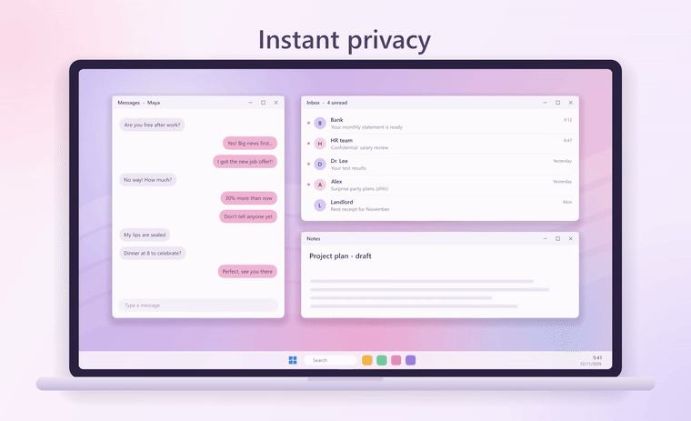
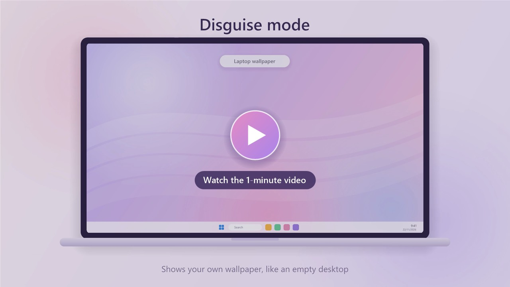
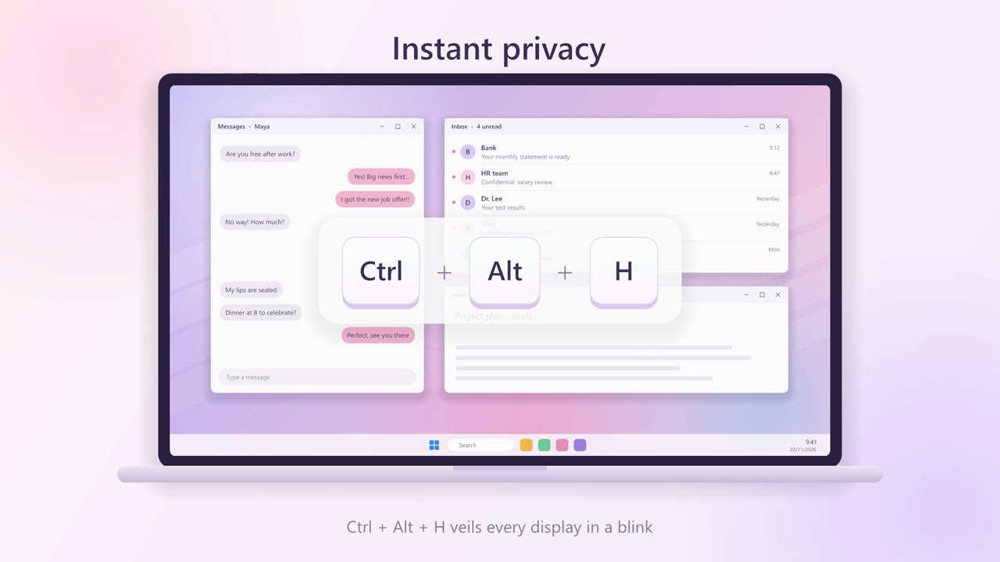
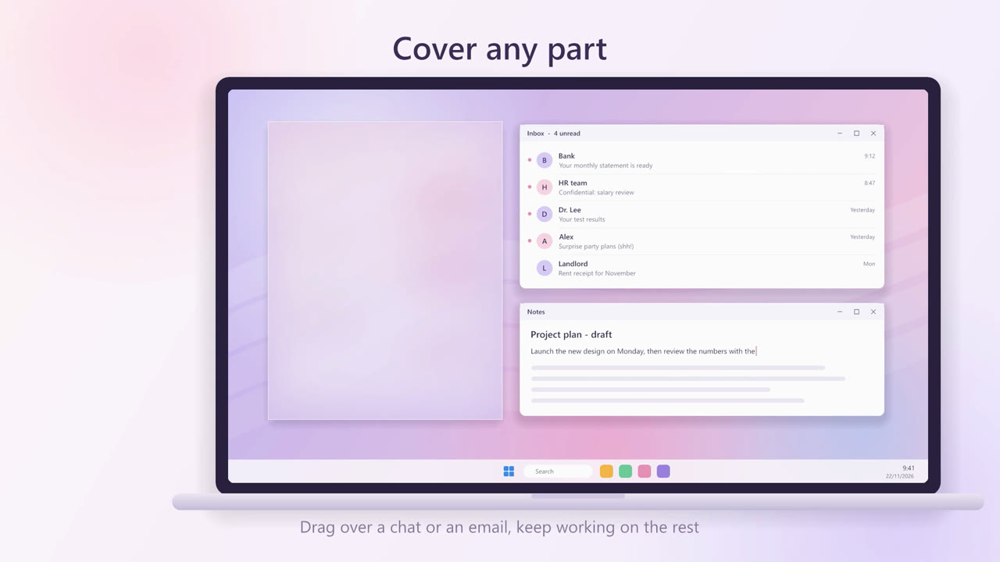
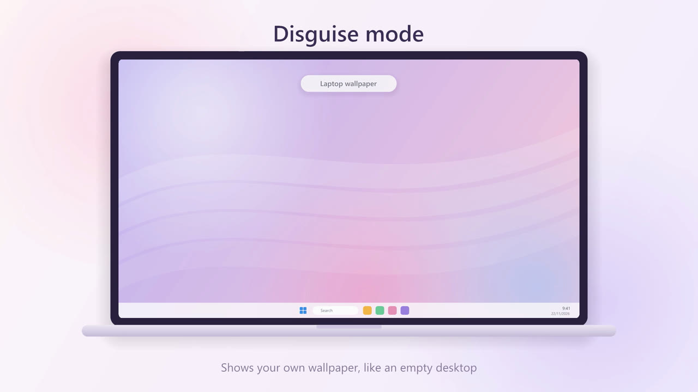
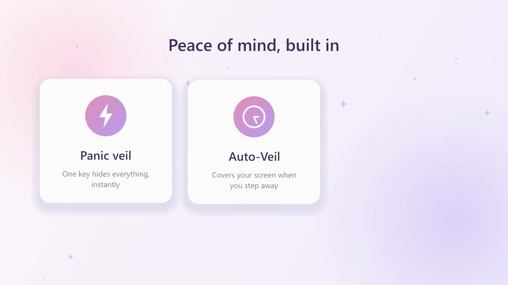

  

<h1 align="center">ScreenVeil</h1>

  <b>A soft privacy curtain for your Windows screen.</b> 
  One shortcut, and everything on your screen melts into a frosted blur.

  

  Click the button, then open <b>ScreenVeil-Setup.exe</b>. That's it.

  

---

## 🎬 See it in action

  

  <a href="https://salmagz.github.io/ScreenVeil-Download/video.html"><b>▶ Watch the video</b></a> (with sound) ·
  <a href="https://github.com/SalmaGz/ScreenVeil-Download/releases/latest/download/ScreenVeil-promo.mp4">Download it</a>

## 💡 What is ScreenVeil?

You're in a café, on a train, or at the office. Someone walks behind you... and your messages, emails and bank tabs are right there on the screen.

**ScreenVeil hides your screen in a second.** Press **Ctrl + Alt + H** and a soft, blurred curtain covers every monitor. Press it again and you're back exactly where you were. Nothing is closed, nothing is lost.

## ✨ What it can do

<table>
  <tr>
    <td width="50%"></td>
    <td width="50%"></td>
  </tr>
  <tr>
    <td><b>Instant privacy</b> Ctrl + Alt + H veils every screen in a blink, with a frosted-glass blur.</td>
    <td><b>Cover just one part</b> Hide a chat or an email and keep working on the rest. Covers are locked in place: only your shortcut removes them.</td>
  </tr>
  <tr>
    <td width="50%"></td>
    <td width="50%"></td>
  </tr>
  <tr>
    <td><b>Disguise mode</b> Show your own wallpaper instead, so it just looks like an empty desktop.</td>
    <td><b>Peace of mind</b> A panic button, an automatic veil when you step away, and nobody can close ScreenVeil without your Windows PIN or password.</td>
  </tr>
</table>

🔒 **100% offline.** No account, no tracking, nothing is ever sent anywhere.

## ⌨️ Shortcuts

| What | Keys |
|---|---|
| Veil / unveil the screen | **Ctrl + Alt + H** |
| Panic veil (instant) | **Ctrl + Alt + P** |
| Switch scene (blur ↔ wallpaper) | **Ctrl + Alt + N** |
| Cover part of the screen / uncover | **Ctrl + Alt + B** |

You can change any shortcut in the app.

## 📥 How to install

1. **[Click here to download](https://github.com/SalmaGz/ScreenVeil-Download/releases/latest/download/ScreenVeil-Setup.exe)** (about 6 MB).
2. Open **ScreenVeil-Setup.exe** from your Downloads.
3. Follow the short setup. No administrator rights needed.

ScreenVeil then lives in the system tray (bottom-right, next to the clock).

> **Windows says "Windows protected your PC"?**
> That's normal for new apps from independent developers. Click **More info**, then **Run anyway**.
>
> **Windows says "Smart App Control blocked an app"?**
> Your PC has Smart App Control turned on, which only allows apps from known publishers. A **Microsoft Store** version of ScreenVeil is on the way and will install without this message.

**Works on:** Windows 10 (version 1809 or later) and Windows 11, 64-bit.

**To uninstall:** Settings → Apps → Installed apps → ScreenVeil → Uninstall.

## ❓ Questions

**Is it free?** Yes.

**Does it collect any data?** No. ScreenVeil works fully offline and never connects to the internet.

**Can someone peek with Alt+Tab or Task View?** No. While your screen is veiled or part of it is covered, Task View (Win+Tab) and Alt+Tab are blocked (and Start too while veiled). A touchpad swipe can't be blocked by any app, so if Task View opens that way, ScreenVeil closes it in a fraction of a second, again and again for as long as the swipe lasts.

**I downloaded it before 23 November 2026. How do I update?** Download it again with the button above and run the installer. Your settings are kept.

**The veil won't go away!** Press **Ctrl + Alt + H** again. A cover won't go away? Press **Ctrl + Alt + B**.

**Where's the source code?** ScreenVeil is free to use but not open source, so this page only shares the app itself.

## 📄 License

ScreenVeil is free to download and use, but it is **not open source**. Please don't re-upload, sell or modify the app, its video or its artwork; sharing a link to this page is always welcome. See [LICENSE](LICENSE) for the full terms.

---

  

© 2026 ScreenVeil (SalmaGz). All rights reserved.

